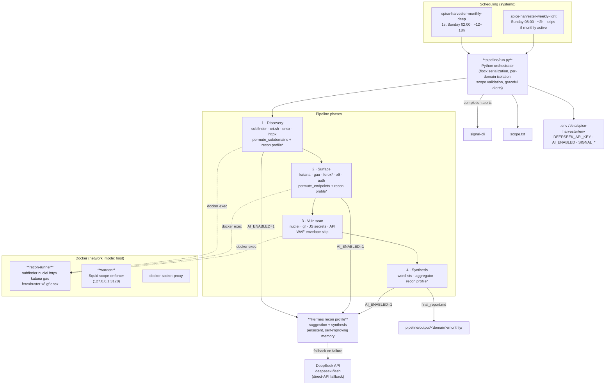

# Spice Harvester — Architecture

## Component notes

| Layer | Component | Role |
|---|---|---|
| Orchestrator | `pipeline/run.py` | Python driver; two tiers (`monthly` deep / `weekly` light); per-target `flock`; scope validation; per-domain exception isolation |
| Discovery | subfinder, crt.sh, dnsx, httpx | Subdomain enumeration + liveness (+ tech/CDN detection for synthesis and WAF envelope) |
| Enrichment | `permute_subdomains.py`, `permute_endpoints.py` | Deterministic (no-LLM) candidate generation — always runs |
| AI layer | Hermes `recon` profile, `hermes_recon.py` | Agent-driven suggestion + synthesis with persistent memory (`AI_ENABLED=1`); falls back to `ai_suggest.py` / `synthesis_gate.py` on failure |
| Surface | katana, gau, feroxbuster (monthly), x8 | URL + parameter + auth-endpoint discovery |
| Vuln | nuclei (targeted + broad), gf, `js_secrets.py`, API probes | Finding triage; WAF-envelope detection skips doomed scans |
| Synthesis | `synthesis_aggregator.py`, `synthesis_gate.py` | Aggregates scan output → single gate → `final_report.md` |
| Containers | recon-runner, warden, docker-socket-proxy | All tools run in the recon container; warden enforces scope; socket-proxy mediates the Docker API |
| Alerts | signal-cli | Pipeline start/failure/completion notifications |

`*` feroxbuster and the broad nuclei pass run only on the monthly tier. The recon profile is created with `./recon-profile/setup.sh`; see `recon-profile/README.md`.
